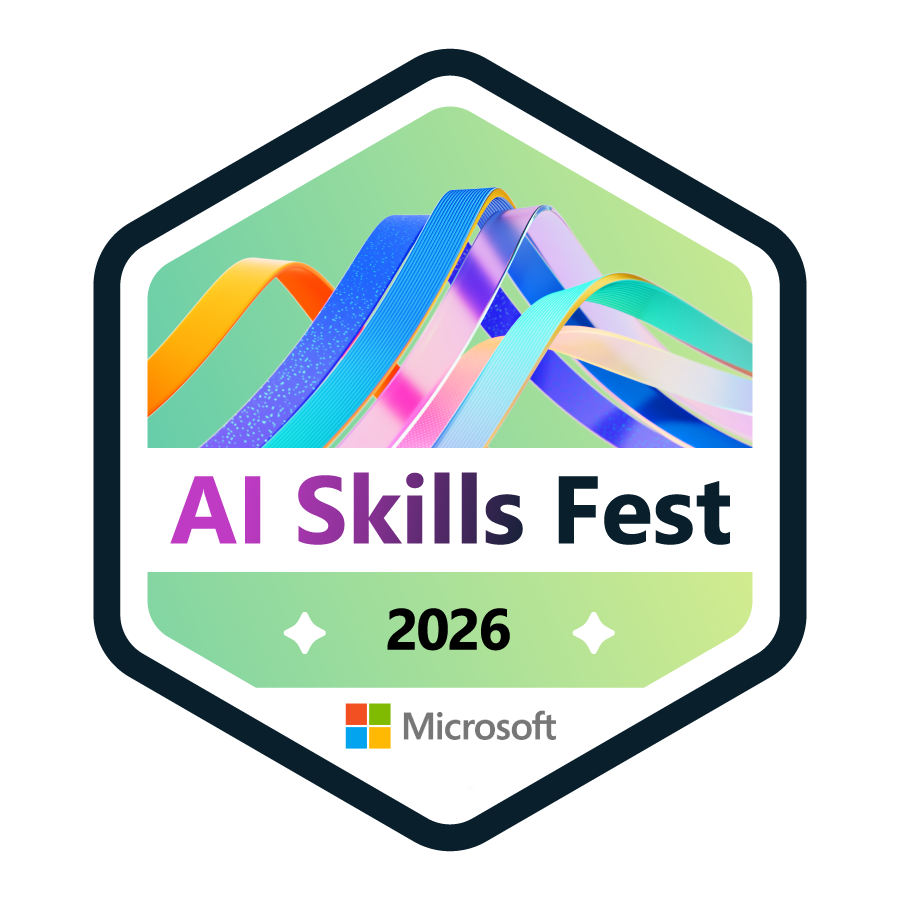
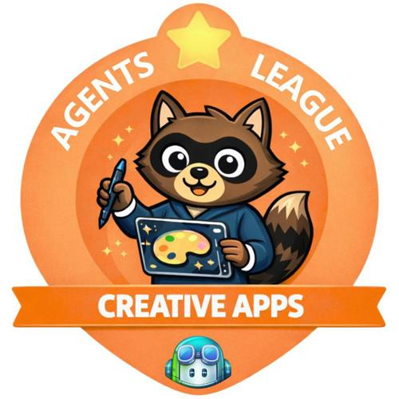

  

  
  
  

  <b>First-year B.E. Computer Science student at Rajalakshmi Engineering College, Tamil Nadu, India.</b> 
  I build practical, deployed applications in <b>AI</b>, <b>backend development</b> and <b>accessibility</b>.

---

## About

I learn by shipping. My projects are working applications with validation, deployment and clear limits, not notebooks that stop at "it runs on my machine". I'm building depth in Python backends, machine learning, and the Linux and security fundamentals that sit underneath them.

---

## Featured Projects

### Jaundice Detector

A web app that screens for possible jaundice from a photo of the eye. An eye-detection step runs first and rejects unsuitable images before the classifier sees them, so the model isn't forced to guess on irrelevant input.

| | |
| --- | --- |
| **What it does** | Upload an eye photo and receive a screening result from a trained image classifier |
| **Engineering focus** | Input validation and eye-detection gating to keep predictions meaningful |
| **Stack** | Python, Flask, PyTorch, Railway |
| **Code** | [GitHub repository](https://github.com/GOKULNATH20072008/jaundice_detector) |

> A screening aid only, not a medical diagnosis. Anyone concerned about their health should see a doctor.

### AccessBridge

An accessibility project for people who can't comfortably use a standard keyboard and mouse.

| | |
| --- | --- |
| **Desktop version** | Voice commands and Morse code input for hands-light computer control (Python) |
| **Web widget (in progress)** | A one-switch, auto-scanning widget that lets any site be operated with a single button |
| **Why it matters** | One-switch access removes the need for a full keyboard or mouse |
| **Stack** | Python, JavaScript |
| **Code** | [GitHub repository](https://github.com/GOKULNATH20072008/AccessBridge) |

---

## Tech Stack

  

| Area | Tools |
| --- | --- |
| Languages | Python, SQL, JavaScript (basics) |
| Backend | Flask, REST APIs, PostgreSQL |
| AI / ML | PyTorch, RAG concepts, LLM-powered applications |
| Tools | Git, GitHub, Linux, VS Code, Railway |

---

## Certifications

  
  &nbsp;&nbsp;
  

- **HarvardX CS50P**, Introduction to Programming with Python ([verify](https://cs50.harvard.edu/certificates/6875fd2b-052c-4fd0-b5e8-7b31f6f44857))
- **Microsoft AI Skills Fest 2026** ([verify on Credly](https://www.credly.com/badges/61e95310-c846-4c93-942e-fd31c04e6e18/public_url))
- **Microsoft Agent League, Creative Apps** ([verify](https://globalai.community/badges/4dc37738-5799-4b44-a017-66e984390f6f))

---

## Hackathons

- **HackerRank Orchestrate (2026):** built an AI agent for buy-or-wait financial decisions
- **BME Ignite Hackfest 2026:** 24-hour biomedical hackathon, team of three

---

## Currently Working On

- Backend development with Flask and PostgreSQL
- Retrieval-augmented generation (RAG) and LLM-powered applications
- Data structures and algorithms
- Linux administration and cybersecurity fundamentals
- Turning AccessBridge into an embeddable web widget

---

## GitHub Stats

  

---

## Connect

I'm open to internships, open-source collaboration and hackathon teams. The fastest way to reach me is through GitHub.

  
  
  

  

